# User Flows

> **Purpose**: Document the paths users take through WAVE.

---

## Flow Documentation Format

Each flow includes:
- **Who**: Primary persona(s) this flow serves
- **Job**: The JTBD (jobs to be done) this flow accomplishes
- **Entry Points**: Where does the user start?
- **Diagram**: Mermaid flowchart showing the path
- **Decision Points**: Branches and their triggers
- **Success State**: What does "done" look like?
- **Error Recovery**: What if something goes wrong?

---

## 1. Create a Test

### Who
**Will** (daily), **Ashley** (when building new automation)

### Job
"Create a test for [feature] so I can catch regressions"

### Entry Points

Users start from the Tests page:

| Entry Point | When Used | Suite Assignment |
|-------------|-----------|------------------|
| **Tests nav → + New Test** | Exploring an idea, Suite undecided | Optional (can assign later) |

### Flow Diagram

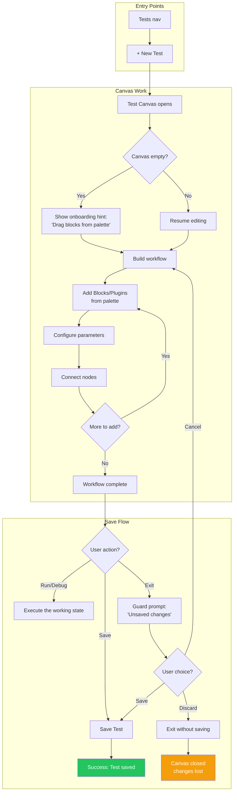

### Decision Points

| Decision | Trigger | Options |
|----------|---------|---------|
| **Save or Discard?** | Exit with unsaved changes | Save and continue / Discard and continue / Cancel |

### Success States

| Outcome | Indicator | Next Action Available |
|---------|-----------|----------------------|
| **Test saved** | Toast: "Test saved" | Run, Debug, Edit |

### Suite Assignment (Separate Action)

Assignment is **not** part of the Save flow. It's a deliberate action the user takes when ready:

| Method | Where | When Used |
|--------|-------|-----------|
| **Bulk assign** | Tests list - select multiple → "Add to Suite" | Organizing many tests |

### Error Recovery

| Error | User Sees | Recovery Path |
|-------|-----------|---------------|
| **Validation error** (missing required field) | Inline error on field, Save blocked | Fix the field, retry Save |
| **Network error** (save failed) | Toast: "Couldn't save. Retry?" + Retry button | Retry or continue editing (work not lost) |

### Edge Cases

- **Empty canvas save**: Allowed. Creates a placeholder Test. Useful for "I'll finish this later."
- **Very large workflow**: Canvas supports zoom/pan. No artificial node limit. Performance tested to 200+ nodes.

---

## 2. Run a Regression

### Who
**Will** (execution), **Edward** (monitoring), **Valerie** (analysis)

### Job
"Run a regression suite before release so I know the build is stable"

### Entry Points

| Entry Point | When Used |
|-------------|-----------|
| **Regressions nav → select Regression → Run** | Browsing available regressions |

### Flow Diagram

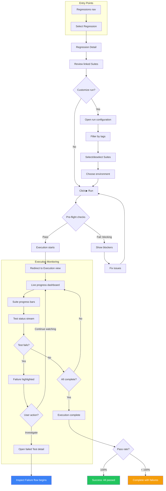

### Decision Points

| Decision | Trigger | Options |
|----------|---------|---------|
| **Customize run?** | User wants subset or different config | Filter tags, select Suites, choose environment |
| **Choose environment** | Running against non-default environment | Select from environment list |
| **Pre-flight blockers** | Invalid config | Fix and retry |
| **Investigate failure?** | Test fails during execution | Inspect Failure or continue monitoring |

### Success States

| Outcome | Indicator | Next Action Available |
|---------|-----------|----------------------|
| **All tests passed** | Green checkmark, "26/26 passed" | View report, export results |
| **Partial failure** | Amber warning, "24/26 passed, 2 failed" | Investigate failures, rerun failed only |
| **Execution error** | Red alert, execution halted | View error, fix config, retry |

### Error Recovery

| Error | User Sees | Recovery Path |
|-------|-----------|---------------|
| **Timeout** (test hung) | Test marked timeout, execution continues | Investigate hung test separately |

### Edward's View (Non-Technical)

Edward doesn't need the canvas or debug tools. His flow is simpler:

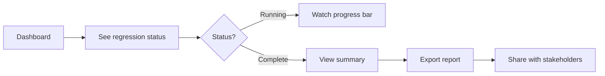

---

## 3. Live Debug

### Who
**Will** (primary), **Ashley** (complex issues)

### Job
"Build and iterate on tests efficiently using interactive debugging"

> This is Will's development environment. He spends more time here than anywhere else.

### Entry Point

| Entry Point | When Used |
|-------------|-----------|
| **Test canvas → Debug ▶** | Building/iterating on a test |

### Flow Diagram

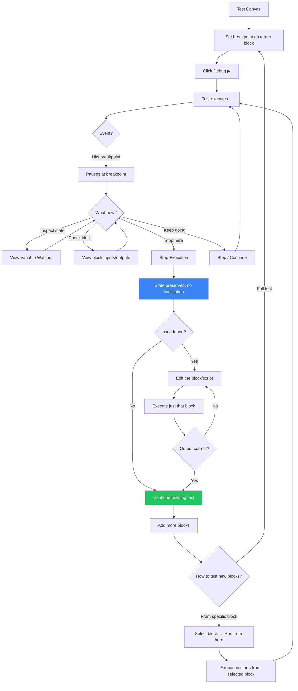

### Features

| Feature | Purpose | How It Helps |
|---------|---------|--------------|
| **Breakpoints** | Pause execution at specific nodes | "Stop here so I can inspect live state" |
| **Stop Execution** | Halt and preserve state | Variables remain populated, no finalization runs |
| **Execute single block** | Run just one block with current state | Test a fix without re-running the whole test |
| **Run from here** | Start execution from any block | Skip already-validated blocks, use existing state |
| **Step over** | Execute one node, pause again | "Let me see what happens next" |
| **Step into** | Enter Block internals | "I need to see inside this Block" |
| **Continue** | Run until next breakpoint | "Skip ahead to the interesting part" |
| **Modify variables** | Change values during pause | "What if I try a different input?" |

### Success States

| Outcome | Indicator |
|---------|-----------|
| **Block works as expected** | Output correct, continue building |
| **Test complete** | All blocks added and verified |

---

## 4. Investigate a Failed Test

### Who
**Will** (quick fixes), **Ashley** (complex issues)

### Job
"Debug why this test failed so I can fix it fast"

> Post-mortem investigation after a regression run surfaces a failure.

### Entry Points

| Entry Point | When Used |
|-------------|-----------|
| **Execution view → Failed test → Inspect** | Noticed failure during/after run |
| **Tests list → Status: Failed → Inspect** | Reviewing test health |
| **Notification → Click** | Alert-driven investigation |

### Flow Diagram

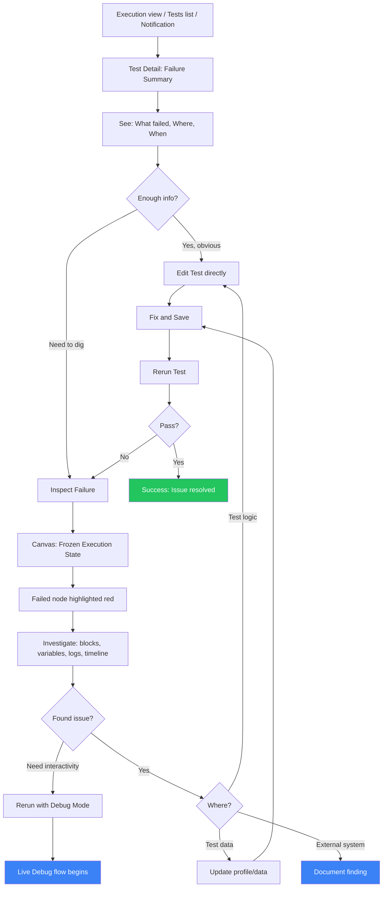

### Inspect Failure Features (Read-Only)

| Feature | Purpose | How It Helps |
|---------|---------|--------------|
| **Failed node highlight** | Instant visual focus | No scrolling through logs to find failure point |
| **Block state colors** | See execution path at a glance | Green (passed), Red (failed), Gray (not reached) |
| **Variable Watcher** | Frozen state at failure moment | "What was the value when it broke?" |
| **Block detail panel** | Click any block to see its I/O and logs | "What did this block receive and return?" |
| **Log panel** | Raw output from plugins | Deep dive when abstractions aren't enough |

### Decision Points

| Decision | Trigger | Options |
|----------|---------|---------|
| **Quick fix or inspect?** | Viewing failure summary | Edit directly (obvious) / Inspect Failure (need to investigate) |
| **Need interactivity?** | During inspection | Continue inspecting / Rerun with Live Debug |
| **Issue location** | After investigation | Test logic / Block / External system / Test data |

### Success States

| Outcome | Indicator | Next Action Available |
|---------|-----------|----------------------|
| **Issue found and fixed** | Test passes on rerun | Mark resolved, update regression |
| **External issue identified** | Documented in execution notes | Create ticket, notify team |

### Error Recovery

| Error | User Sees | Recovery Path |
|-------|-----------|---------------|
| **Execution data expired** (old execution) | "Execution data no longer available" | Rerun test to capture fresh state |

### Ashley's Path (Complex Issues)

When Will can't solve it, Ashley gets pulled in:

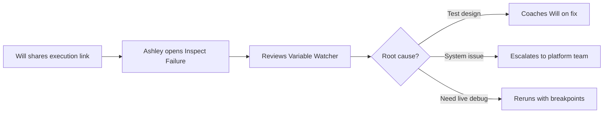

---

## 5. Organize Tests into Suites

### Who
**Will** (day-to-day organization), **Ashley** (architecture decisions)

### Job
"Organize tests into logical groups so I can manage complexity"

### Entry Points

| Entry Point | When Used |
|-------------|-----------|
| **Suites nav → + New Suite** | Creating a new grouping |
| **Tests list → Select tests → Add to Suite** | Adding existing tests to a suite |
| **Suite Detail → Tests list** | Managing tests within a Suite |

### Flow Diagram

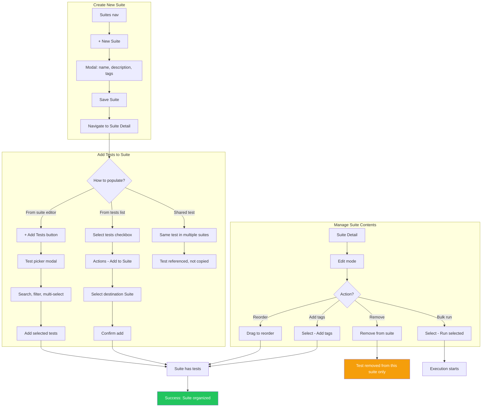

### Key Constraints

| Rule | Rationale |
|------|-----------|
| **Tests can belong to multiple Suites** | Same test reusable across suites (e.g., prep/teardown tests, mini-suites referencing subsets). Suites act as playlists. |
| **Unassigned is valid** | Tests can exist independently (drafts, orphans, standalone) |
| **Adding references, not copies** | Suites reference tests. One test definition, many suite memberships. Updating the test updates it everywhere. |
| **Suites can be empty** | Placeholder for future tests, or all tests removed |
| **Removing does not delete** | Removing a test from a suite only removes the reference. The test itself is unaffected and may remain in other suites. |

### Many-to-Many Model

Tests are independent entities. Suites reference tests like playlists. This enables:

```
Suite: "TLS Validation" (full regression)
├── Test: "Deploy TLS Service" [tag:setup]       <-- shared prep test
├── Test: "Certificate expiry" [tag:critical]
├── Test: "Handshake timeout" [tag:performance]
├── Test: "Cipher negotiation" [tag:security]
└── Test: "Teardown TLS Service" [tag:cleanup]   <-- shared teardown test

Suite: "TLS Quick Smoke" (mini-suite)
├── Test: "Deploy TLS Service" [tag:setup]       <-- same prep test
├── Test: "Certificate expiry" [tag:critical]     <-- same test
└── Test: "Teardown TLS Service" [tag:cleanup]   <-- same teardown test

Suite: "API Health"
├── Test: "Deploy TLS Service" [tag:setup]       <-- same prep test, reused
├── Test: "Endpoint 200" [tag:critical, tag:smoke]
└── Test: "Rate limiting" [tag:performance]
```

Tags provide additional cross-cutting organization alongside suite membership.

### Success States

| Outcome | Indicator |
|---------|-----------|
| **Suite created** | Appears in Suites list, ready for tests |
| **Tests added** | Tests appear in suite's test list. Test remains in any other suites it belongs to. |
| **Tests removed** | Test removed from this suite only. Test itself and other suite memberships unaffected. |

---

## 7. Find and Edit Existing Test

### Who
**Will** (primary - daily task)

### Job
"Find a specific test so I can modify or rerun it"

### Flow Diagram

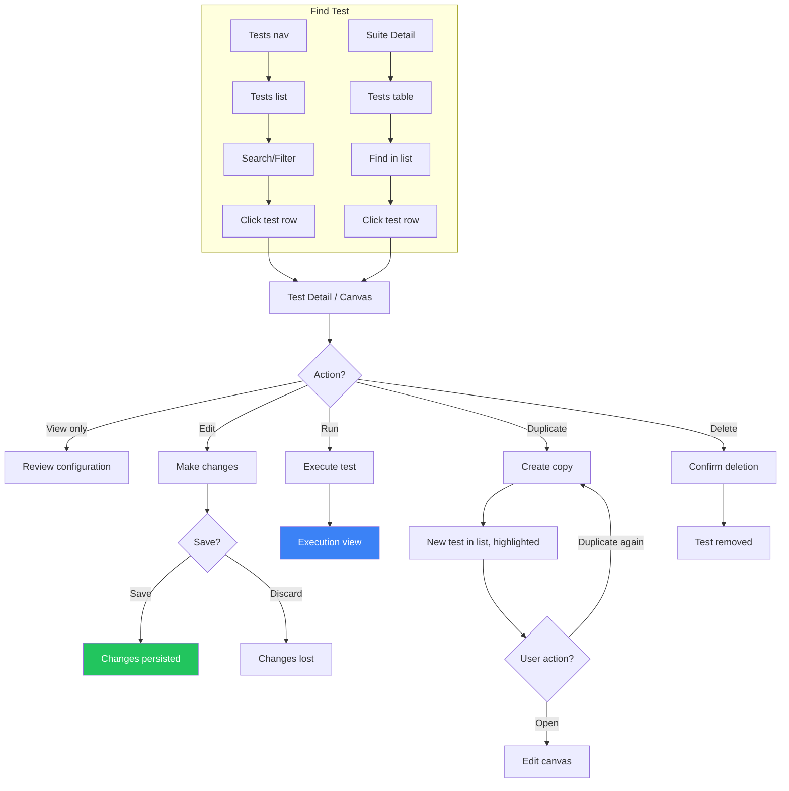

### Search Capabilities

| Method | Best For |
|--------|----------|
| **Tests list + filter** | Browsing, don't know exact name |
| **Suite → Tests table** | Know the Suite, browsing within |
| **Filter by tag** | Cross-cutting query ("all smoke tests") |
| **Filter by status** | "Show me failing tests" |

---

## 8. View Execution History / Analyze Trends

### Who
**Valerie** (primary), **Edward** (reporting)

### Job
"See execution history so I can track patterns and spot anomalies"

### Flow Diagram

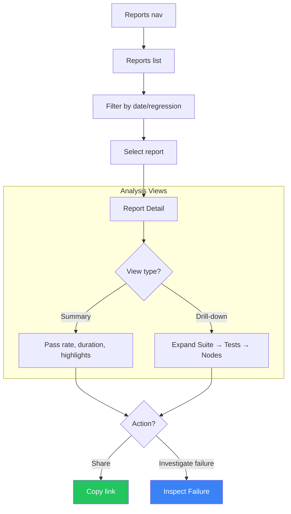

### Edward's Key Questions (Answered by Reports)

| Question | Where to Find Answer |
|----------|---------------------|
| "What's the overall health?" | Summary view: pass rate badge |
| "How long did the regression take?" | Duration in report header |

---

## 9. Error Recovery Patterns

### Universal Error Handling

Every error in WAVE follows this pattern:

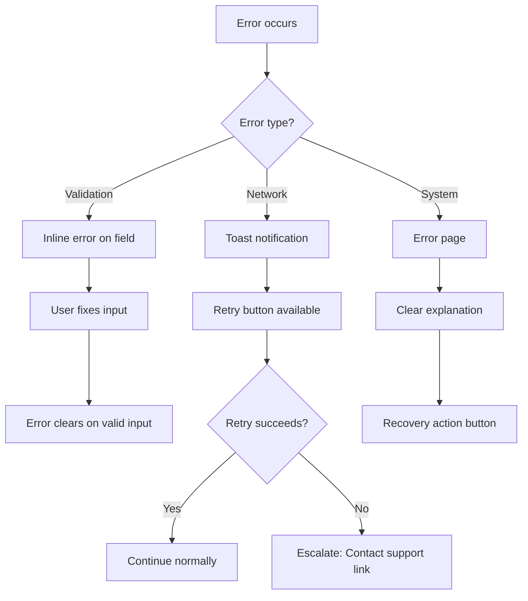

### Conflict Handling Strategy

**Detection**: ETags (optimistic concurrency)
- Fetch entity → receive ETag
- Save → send ETag
- Mismatch → the save fails with a conflict error

### Error Message Quality

Every error message must answer:
1. **What happened?** (Clear, non-technical description)
2. **Why?** (If we know - don't guess)
3. **What can you do?** (Actionable next step)

**Bad**: "Error 500: Internal Server Error"
**Good**: "Couldn't save your test. Our servers are having trouble. [Retry]"

---

## 10. Large Data Navigation

### When There Are 1000+ Items

Applies to: **Tests, Suites, Regressions, Executions, Reports**

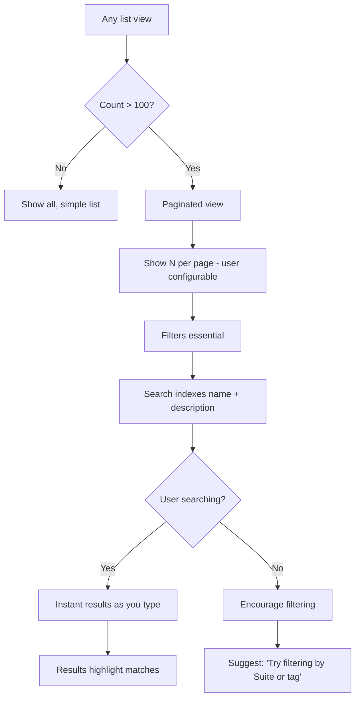

### Pagination Settings

| Setting | Default | Options |
|---------|---------|---------|
| Items per page | 25 | 10, 25, 50, 100 |

The chosen page size is kept in the page URL.

### Performance Commitments

| Scenario | Target |
|----------|--------|
| Initial list load (1000 items) | < 500ms |
| Filter application | < 200ms |
| Search results | < 100ms (debounced) |
| Pagination | < 200ms |

---

## 11. Manage Environments

### Who
**Ashley** (primary - environment setup), **Will** (selecting environment for runs)

### Job
"Configure environments so I can run tests against different labs/clusters/namespaces"

### Key Concepts

**Environment**: A named target configuration (e.g., "Dev-West-App2")
- Flat list (not hierarchical)
- Tags for flexible categorization (e.g., `dev`, `west`, `app2`)

**Profile + Environment**: Each Profile has values *per environment*
- Profile "Shared DB" might have same values across all Dev envs (shared resource)
- Profile "Cluster Access" has different values per environment (unique credentials)

### Flow: Add New Environment

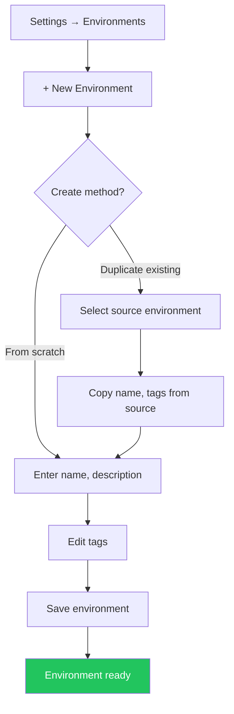

### Flow: Add Profile Values for New Environment

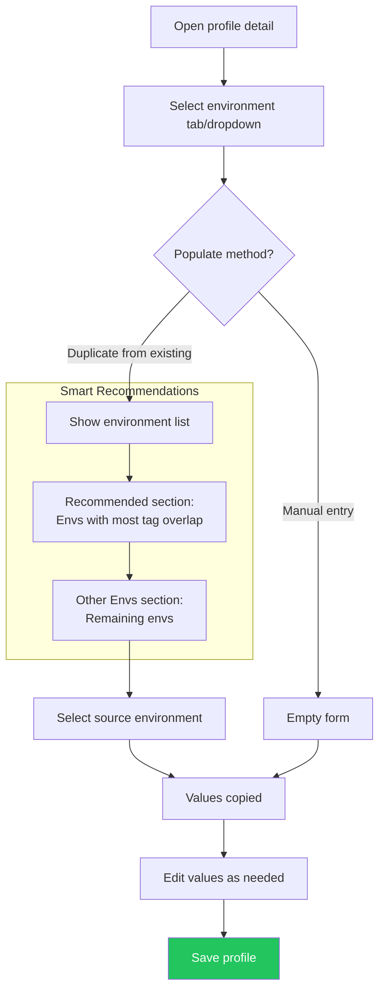

### Recommendation Logic

When Ashley duplicates profile values to a new environment, WAVE sorts source environments by **tag overlap**:

```
New environment: "Dev-West-App3"
Tags: [dev, west, app3]

┌─────── Recommended (2 tags match) ───────┐
│ Dev-West-App1      [dev, west, app1]     │
│ Dev-West-App2      [dev, west, app2]     │
├─────── Other (1 tag match) ──────────────┤
│ Dev-East-App1      [dev, east, app1]     │
├─────── Other (0 tags match) ─────────────┤
│ Staging-Central    [staging, central]    │
└──────────────────────────────────────────┘
```

### Flow: Select Environment for Execution

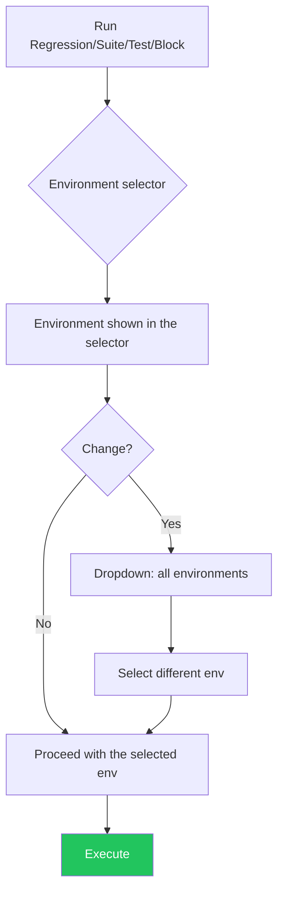

### Decision Points

| Decision | Trigger | Options |
|----------|---------|---------|
| **Create method** | Adding new environment | From scratch / Duplicate existing |
| **Populate method** | Profile needs values for new env | Duplicate from existing / Manual |
| **Source environment** | Duplicating values | Recommended (tag match) / Other |

### Success States

| Outcome | Indicator |
|---------|-----------|
| **Environment created** | Appears in environment list |
| **Profile values added** | Env fully configured |

### Error Recovery

| Error | User Sees | Recovery Path |
|-------|-----------|---------------|
| **Duplicate name** | "Environment 'X' already exists" | Choose different name |

---

## Flow Cross-Reference

| JTBD | Primary Flow | Supporting Flows |
|------|--------------|------------------|
| Create a test | Flow 1 | Flow 3 (live debug) |
| Build automation | Flow 1 | Flow 3 (live debug), Flow 5 (organization) |
| Run a regression | Flow 2 | Flow 8 (history), Flow 11 (environment) |
| Debug a failure | Flow 4 | Flow 7 (find test) |
| Iterate on a test | Flow 3 | Flow 1 (building) |
| Analyze impact | Flow 8 | Flow 2 (execution context) |
| Plan a release | Flow 2 | Flow 8 (reports) |
| Find past results | Flow 8 | Flow 7 (find test) |
| Configure environments | Flow 11 | Flow 2 (execution) |

---
